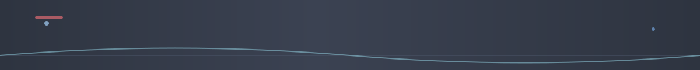

# Adam Neighbors

**Implementation Engineer · Odoo & Python**

I help teams ship dependable software around ERP and operations—custom Odoo work, Python services,
SQL-heavy data flows, and automation that stays observable in production. After more than a decade
building systems across manufacturing, utilities, and home services, I focus on integrations people
can own and delivery that matches how work actually runs. I work primarily on **Linux** (desktop, servers, and containers) and prefer it for development and ops; Windows when the job calls for it.

[Website](https://adamneighbors.com) · [LinkedIn](https://linkedin.com/in/adamneighbors) · [X](https://x.com/onelegchair) · [Instagram](https://instagram.com/adamneighbors)

---

## Featured repositories

| Project | Description |
| --- | --- |
| [**dish-genie**](https://github.com/adamneighbors/dish-genie) | CircuitPython dishwasher timer for the Adafruit MagTag—e-ink UI, LEDs, and deep sleep. |
| [**baseball-stats-dashboard**](https://github.com/adamneighbors/baseball-stats-dashboard) | Django + PostgreSQL + Plotly dashboard for MLB stats. [Live demo](https://baseball.adamneighbors.com). |

---

## Tech

### Languages

### Platforms & frameworks

### Data & integrations

### DevOps & cloud

Self-hosted & homelab

---

## GitHub activity

Stats and activity images are rendered by third-party services; the profile still reads cleanly if they are unavailable.